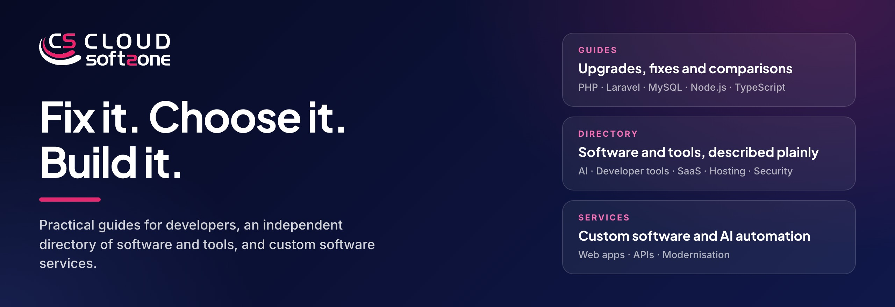

<a href="https://www.cloudsoftzone.com/?utm_source=github&utm_medium=profile&utm_campaign=org-readme"></a>

<p align="center">
  <a href="https://www.cloudsoftzone.com/blog?utm_source=github&utm_medium=profile&utm_campaign=org-readme"></a>
  <a href="https://www.cloudsoftzone.com/tools?utm_source=github&utm_medium=profile&utm_campaign=org-readme"></a>
  <a href="https://www.cloudsoftzone.com/services?utm_source=github&utm_medium=profile&utm_campaign=org-readme"></a>
  <a href="https://www.cloudsoftzone.com/submit-listing?utm_source=github&utm_medium=profile&utm_campaign=org-readme"></a>
</p>

## Start here

<table>
  <tr>
    <td width="72" align="center" valign="top"><a href="https://www.cloudsoftzone.com/blog?utm_source=github&utm_medium=profile&utm_campaign=org-readme"></a></td>
    <td valign="top">
      <b><a href="https://www.cloudsoftzone.com/blog?utm_source=github&utm_medium=profile&utm_campaign=org-readme">Developer guides</a></b><br>
      Upgrades, version comparisons and fixes for PHP, Laravel, MySQL, Node.js and TypeScript, written against official documentation and release notes.<br>
      <a href="https://www.cloudsoftzone.com/blog?utm_source=github&utm_medium=profile&utm_campaign=org-readme"><b>Browse the guides →</b></a>
    </td>
  </tr>
  <tr>
    <td width="72" align="center" valign="top"><a href="https://www.cloudsoftzone.com/tools?utm_source=github&utm_medium=profile&utm_campaign=org-readme"></a></td>
    <td valign="top">
      <b><a href="https://www.cloudsoftzone.com/tools?utm_source=github&utm_medium=profile&utm_campaign=org-readme">Tools directory</a></b><br>
      AI tools, developer tools, SaaS, hosting, security products and agencies. Each listing gives the pricing model, platforms and whether there is a free plan.<br>
      <a href="https://www.cloudsoftzone.com/tools?utm_source=github&utm_medium=profile&utm_campaign=org-readme"><b>Find a tool →</b></a>
    </td>
  </tr>
  <tr>
    <td width="72" align="center" valign="top"><a href="https://www.cloudsoftzone.com/services?utm_source=github&utm_medium=profile&utm_campaign=org-readme"></a></td>
    <td valign="top">
      <b><a href="https://www.cloudsoftzone.com/services?utm_source=github&utm_medium=profile&utm_campaign=org-readme">Software services</a></b><br>
      Custom software development, application modernisation, API integration and AI automation for founders and small businesses.<br>
      <a href="https://www.cloudsoftzone.com/services?utm_source=github&utm_medium=profile&utm_campaign=org-readme"><b>See what we build →</b></a>
    </td>
  </tr>
</table>

## Quick answers

Short versions of the guides developers open most. Each links to the full walk-through.

### `DisposableStack is not defined`

The runtime does not support it yet: Safari on Mac, every browser on iOS, and Node.js before 24. Update the runtime or load a polyfill. After that, `using` cleans up for you, in reverse order:

```js
const res = (name) => ({ [Symbol.dispose]() { console.log(`dispose ${name}`); } });
{
  using a = res('a');
  using b = res('b');
  console.log('body');
}
// body
// dispose b
// dispose a
```

[Full guide: fix the error and use JavaScript `using` →](https://www.cloudsoftzone.com/blog/javascript-using-declarations-explicit-resource-management?utm_source=github&utm_medium=profile&utm_campaign=org-readme)

### Which MySQL version should I run?

| You are on | Do this |
| --- | --- |
| A new project | Start on 9.7 LTS |
| 8.4 LTS | Plan the move to 9.7 LTS within the next year |
| 8.0 | Go to 8.4 LTS first: 8.0 cannot go straight to 9.7 |
| Looking at 26.7 | It is an Innovation release: keep it for development and test |

[Full guide: 8.4 LTS, 9.7 LTS or 26.7 Innovation, with the upgrade checklist →](https://www.cloudsoftzone.com/blog/mysql-8-4-vs-9-7-lts-vs-26-7-innovation-upgrade-checklist?utm_source=github&utm_medium=profile&utm_campaign=org-readme)

### Run TypeScript in Node.js without a build step

```console
$ node src/main.ts
```

Node.js strips the types and runs the file. Enums, decorators and path aliases are where it breaks.

[Full guide: type stripping vs tsx vs tsc, and which to pick →](https://www.cloudsoftzone.com/blog/run-typescript-in-node-js-type-stripping-vs-tsx-vs-tsc?utm_source=github&utm_medium=profile&utm_campaign=org-readme)

### Is my Laravel app ready for PHP 8.5?

```console
$ composer why-not php 8.5.0     # packages whose constraints exclude 8.5
$ composer outdated --direct     # direct dependencies with newer releases
```

[Full guide: compatibility, deprecations and tests →](https://www.cloudsoftzone.com/blog/upgrade-laravel-app-to-php-8-5-compatibility-test-plan?utm_source=github&utm_medium=profile&utm_campaign=org-readme)

### Connect to MySQL from the command line

```console
$ mysql -h 127.0.0.1 -P 3306 -u app -p shop
mysql> SELECT DATABASE(), CURRENT_USER(), @@version;
```

[Full guide: socket versus TCP, TLS, option files and common errors →](https://www.cloudsoftzone.com/blog/connect-to-a-mysql-database-using-the-command-line?utm_source=github&utm_medium=profile&utm_campaign=org-readme)

## Latest guides

<!-- latest:start -->
- [MySQL vs PostgreSQL for SaaS hosting: operational differences small teams should evaluate](https://www.cloudsoftzone.com/blog/mysql-vs-postgresql-saas-hosting-operations?utm_source=github&utm_medium=profile&utm_campaign=org-readme) · DevOps
- [MAI Code 1.1 Flash: what local Windows inference needs](https://www.cloudsoftzone.com/blog/mai-code-1-1-flash-local-windows?utm_source=github&utm_medium=profile&utm_campaign=org-readme) · AI and Automation
- [MySQL production configuration for Laravel applications: a safe operating baseline](https://www.cloudsoftzone.com/blog/mysql-production-configuration-laravel-applications?utm_source=github&utm_medium=profile&utm_campaign=org-readme) · DevOps
- [Domains and hosting: GoDaddy vs Namecheap vs IONOS](https://www.cloudsoftzone.com/blog/domains-hosting-godaddy-namecheap-ionos?utm_source=github&utm_medium=profile&utm_campaign=org-readme) · Reviews
- [Production incident checklist: a recovery runbook for small SaaS teams](https://www.cloudsoftzone.com/blog/production-incident-checklist-recovery-runbook?utm_source=github&utm_medium=profile&utm_campaign=org-readme) · DevOps
- [GitHub Copilot computer use: setup and desktop safeguards](https://www.cloudsoftzone.com/blog/github-copilot-computer-use-desktop?utm_source=github&utm_medium=profile&utm_campaign=org-readme) · AI and Automation
<!-- latest:end -->

<sub>This list updates itself every day.</sub> [All guides →](https://www.cloudsoftzone.com/blog?utm_source=github&utm_medium=profile&utm_campaign=org-readme)

## Browse by topic

**Guides:** [Laravel](https://www.cloudsoftzone.com/blog/category/laravel?utm_source=github&utm_medium=profile&utm_campaign=org-readme) · [PHP](https://www.cloudsoftzone.com/blog/category/php?utm_source=github&utm_medium=profile&utm_campaign=org-readme) · [JavaScript](https://www.cloudsoftzone.com/blog/category/javascript?utm_source=github&utm_medium=profile&utm_campaign=org-readme) · [Node.js](https://www.cloudsoftzone.com/blog/category/node-js?utm_source=github&utm_medium=profile&utm_campaign=org-readme) · [MySQL](https://www.cloudsoftzone.com/blog/category/mysql?utm_source=github&utm_medium=profile&utm_campaign=org-readme) · [DevOps](https://www.cloudsoftzone.com/blog/category/devops?utm_source=github&utm_medium=profile&utm_campaign=org-readme) · [WordPress](https://www.cloudsoftzone.com/blog/category/wordpress?utm_source=github&utm_medium=profile&utm_campaign=org-readme) · [Magento](https://www.cloudsoftzone.com/blog/category/magento?utm_source=github&utm_medium=profile&utm_campaign=org-readme) · [CodeIgniter](https://www.cloudsoftzone.com/blog/category/codeigniter?utm_source=github&utm_medium=profile&utm_campaign=org-readme) · [CakePHP](https://www.cloudsoftzone.com/blog/category/cakephp?utm_source=github&utm_medium=profile&utm_campaign=org-readme) · [AI and automation](https://www.cloudsoftzone.com/blog/category/ai-and-automation?utm_source=github&utm_medium=profile&utm_campaign=org-readme) · [SaaS and cloud](https://www.cloudsoftzone.com/blog/category/saas-and-cloud?utm_source=github&utm_medium=profile&utm_campaign=org-readme) · [Development](https://www.cloudsoftzone.com/blog/category/development?utm_source=github&utm_medium=profile&utm_campaign=org-readme) · [Business technology](https://www.cloudsoftzone.com/blog/category/business-technology?utm_source=github&utm_medium=profile&utm_campaign=org-readme) · [Reviews](https://www.cloudsoftzone.com/blog/category/reviews?utm_source=github&utm_medium=profile&utm_campaign=org-readme) · [Interview questions](https://www.cloudsoftzone.com/blog/category/interview-questions?utm_source=github&utm_medium=profile&utm_campaign=org-readme) · [Resources](https://www.cloudsoftzone.com/blog/category/resources?utm_source=github&utm_medium=profile&utm_campaign=org-readme)

**Tools:** [AI tools](https://www.cloudsoftzone.com/tools/category/ai-tools?utm_source=github&utm_medium=profile&utm_campaign=org-readme) · [Developer tools](https://www.cloudsoftzone.com/tools/category/developer-tools?utm_source=github&utm_medium=profile&utm_campaign=org-readme) · [SaaS](https://www.cloudsoftzone.com/tools/category/saas?utm_source=github&utm_medium=profile&utm_campaign=org-readme) · [Hosting and cloud](https://www.cloudsoftzone.com/tools/category/hosting-and-cloud?utm_source=github&utm_medium=profile&utm_campaign=org-readme) · [Security](https://www.cloudsoftzone.com/tools/category/security?utm_source=github&utm_medium=profile&utm_campaign=org-readme) · [Productivity](https://www.cloudsoftzone.com/tools/category/productivity?utm_source=github&utm_medium=profile&utm_campaign=org-readme) · [Agencies](https://www.cloudsoftzone.com/tools/category/agencies?utm_source=github&utm_medium=profile&utm_campaign=org-readme)

## Work with us

<table>
  <tr>
    <td valign="top">
      <b>Is your product missing?</b><br>
      We list software, tools and technology services that are useful to developers, founders and small businesses. Listings are written by our editors from your public website.<br>
      <a href="https://www.cloudsoftzone.com/submit-listing?utm_source=github&utm_medium=profile&utm_campaign=org-readme"><b>Submit a listing →</b></a>
    </td>
  </tr>
  <tr>
    <td valign="top">
      <b>Need something built?</b><br>
      Tell us what you are trying to ship: a new web application, an old one that needs modernising, an integration between systems, or an AI workflow.<br>
      <a href="https://www.cloudsoftzone.com/services?utm_source=github&utm_medium=profile&utm_campaign=org-readme"><b>Services →</b></a> &nbsp; <a href="https://www.cloudsoftzone.com/contact?utm_source=github&utm_medium=profile&utm_campaign=org-readme"><b>Contact →</b></a>
    </td>
  </tr>
</table>

<p align="center">
  <a href="https://linkedin.com/company/cloudsoftzone">LinkedIn</a> ·
  <a href="https://x.com/cloudsoftzone">X</a> ·
  <a href="https://www.facebook.com/cloudsoftzone">Facebook</a> ·
  <a href="https://www.instagram.com/cloudsoftzone">Instagram</a> ·
  <a href="https://in.pinterest.com/cloudsoftzone/">Pinterest</a> ·
  <a href="mailto:contact@cloudsoftzone.com">contact@cloudsoftzone.com</a>
</p>
